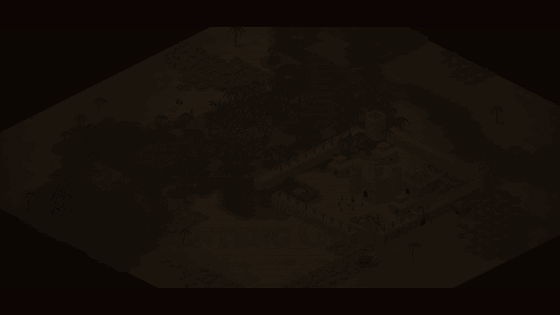

# Benteng Gurun

[Trailer 1080p (MP4)](media/benteng-gurun-trailer.mp4)

Game strategi benteng isometrik di browser, terinspirasi *Stronghold Crusader*. Bangun ekonomi di tepi sungai oasis, dirikan tembok dan menara, latih pasukan, dan bertahan dari 10 gelombang musuh.

Buka `index.html` di browser (desktop atau HP). Tidak perlu instalasi.

## Mode
- **Kampanye (5 misi)**, terbuka berurutan, dengan bintang per misi:
  1. *Oasis Pertama*: tutorial terpandu 14 langkah. Tombol yang harus diketuk berdenyut, panah emas menunjuk lokasi di peta, dan gelombang pertama menunggu sampai kamu siap (paling lama 6 menit).
  2. *Sungai Kering*: sungai mengering sehingga musuh menyeberang hampir di mana saja; palem langka.
  3. *Tiga Penyeberangan*: anak sungai di utara dengan satu titik dangkal; serangan dari utara mulai gelombang 3.
  4. *Lembah Batu*: punggung tebing yang tak bisa dilewati, hanya dua celah; ketapel sejak gelombang 4.
  5. *Pengepungan Besar*: 12 gelombang di sekitar danau oasis, tangga sejak gelombang 2.
- Setiap misi dibuka dengan briefing cerita (Laskar Panji Biru melawan rakyat Oasis Wadi Hijau) dan kampanye ditutup dengan epilog.
- **Pertempuran bebas**: 10 gelombang dengan tingkat Mudah/Normal/Sulit dan rekor skor.

## Cara bermain
- **Penebang** dekat pohon palem → kayu. **Tambang Batu** di atas batu abu-abu → batu. **Kebun Kurma** di tanah hijau → makanan.
- **Rumah** menambah batas rakyat. Popularitas ≥ 50 menarik rakyat baru; atur pajak lewat tombol rakyat/hati di atas.
- **Barak** melatih rakyat menganggur menjadi Tombak, Pemanah, atau Ksatria.
- **Tembok** (seret untuk satu baris), **Gerbang** (pasukanmu bisa lewat), **Menara** (memanah otomatis).
- **Pemanah di atas tembok/menara**: jangkauan +2 (menara +3), panah musuh berkurang 40%, dan tombak musuh tidak bisa menjangkau.
- **Air Mancur** menambah popularitas, jadi pajak bisa dinaikkan.
- Musuh datang dari barat lewat tiga titik dangkal sungai. Mulai gelombang 4 ada pendobrak, gelombang 5 juga dari utara, dan gelombang 6 ada ketapel yang menembak bangunan dari jauh.
- **Sang Penguasa**: pahlawanmu (600 HP). Pasukan dalam 3,5 petak darinya memberi kerusakan +20%. Jika ia gugur, kamu kalah. Di bawah 35% HP ia berlindung di dalam Benteng Utama, pulih, lalu keluar lagi; bisa juga disuruh masuk lewat panel unit.
- **Tangga pengepung** (mulai gelombang 3): Pembawa Tangga memasang tangga di tembok terdekat, lalu musuh memanjat masuk. Pemanah bisa menembak mereka di jalan; Tombak di atas tembok bertarung di tangga dan otomatis mendorongnya jatuh.
- **Jebakan** (seret untuk memasang) tersembunyi dari musuh. **Gerbang** bisa ditaruh di atas tembok.
- Ketuk **Benteng Utama** untuk 4 peningkatan (tembok, menara, busur, zirah) dan memperbaiki semua bangunan. Bangunan rusak bisa diperbaiki dengan batu, kecuali saat musuh dekat.
- Prajurit dilatih dengan emas + kayu. Palem tumbuh kembali perlahan di oasis.
- Skor dan bintang (1–3) per tingkat kesulitan, rekor tersimpan di perangkat. Menu jeda: suara, cara bermain, mulai ulang.
- Musik latar generatif (petikan ala oud di atas dengung, tabuhan rebana saat pertempuran), bisa dimatikan terpisah dari efek suara di menu jeda.
- Kartu tujuan/tutorial bisa dilipat dengan mengetuknya.
- Menu jeda: opsi **Grafik: hemat baterai** (kanvas resolusi 1×) untuk HP yang lebih lemah. Pasukan, tembok, dan bangunan digambar dari cache sprite, jadi biaya JavaScript per frame tetap rendah.
- Tiga tingkat kesulitan, daftar tujuan berhadiah untuk pemula, simpan otomatis tiap hari (tombol *Lanjutkan*), minimap, efek suara sintetis.

## Kontrol
| Aksi | HP | Desktop |
|---|---|---|
| Geser peta | seret satu jari (dua jari saat membangun) | klik kanan + seret, WASD/panah |
| Zoom | cubit | roda mouse |
| Pilih pasukan | ketuk prajurit, "Semua pasukan", atau "Pilih kotak" | klik, atau seret kotak |
| Gerak / serang | ketuk tanah / ketuk musuh | klik kiri atau kanan |
| Pindah cepat | ketuk peta kecil / penunjuk musuh | sama |
| Pemanah ke tembok | tombol | F |
| Sang Penguasa | tombol Penguasa | L |
| Semua pasukan / ke benteng | tombol Pasukan / peta kecil | Q / H |
| Kecepatan | tombol 1× | 1, 2, 3 |
| Jeda / menu | tombol Jeda | Spasi, Esc |

---

## Pengukur RSI (`rsi/index.html`)

Aplikasi web terpisah untuk mengukur *Reactive Strength Index* drop jump. Buka `rsi/index.html` di browser, pilih video drop jump (slow-motion lebih akurat), lalu tandai tiga frame: kontak, take-off, dan mendarat. Aplikasi menghitung waktu kontak, tinggi lompatan (`g · t_layang² / 8`), dan `RSI = tinggi (m) / waktu kontak (s)`. Ada juga input manual dan riwayat yang tersimpan di browser (bisa disalin sebagai CSV).
